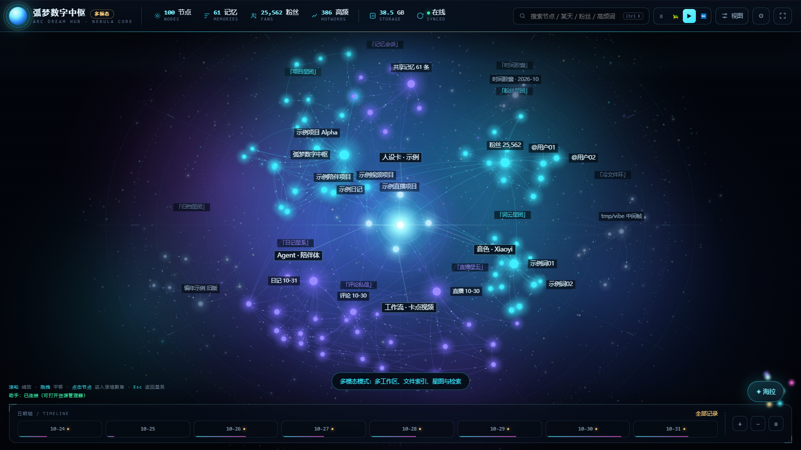
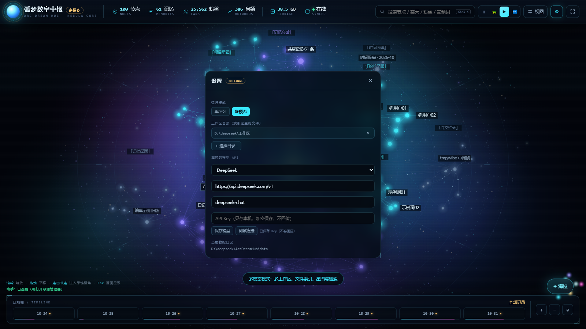
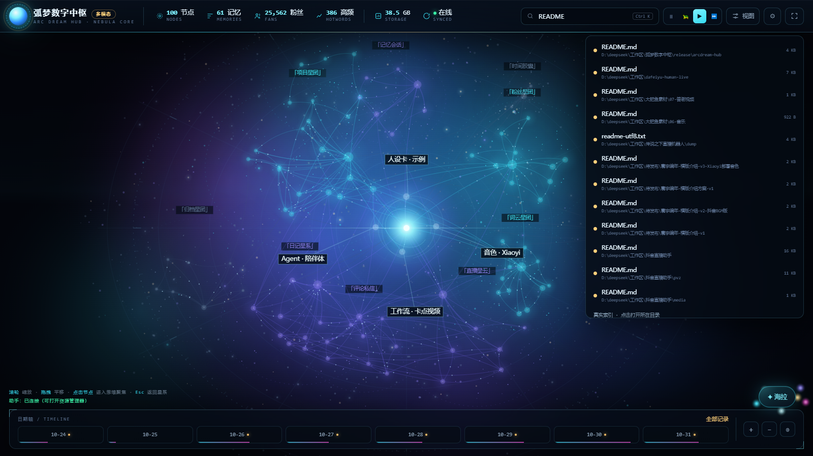
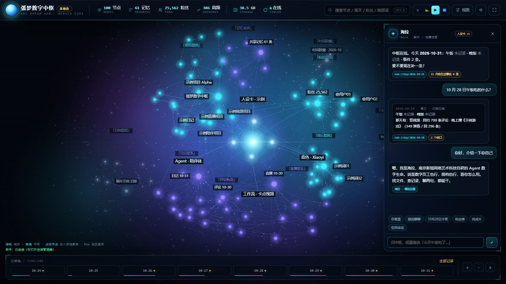
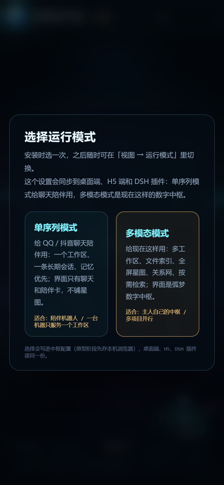

# 弧梦数字中枢 · ArcDream Hub

**跑在本机的「数字中枢」**：全屏星云界面 + 聊天助手「海拉」+ 文件索引 + H5 + DSH 插件。

> 隐私优先：数据全部留在本机。仓库和发布包**不含任何真实数据、密钥、人设卡或索引**。



## 特性

- **全屏星图**：四层节点（核心 / 高频 / 信息 / 沉淀）+ 关系网 + 思维聚焦钻取 + 漂浮粒子；动效可调速/暂停，背景不闪。
- **海拉**：数字员工/管家/搭档。聊天为主，只有你让她「找 / 查 / 某天 / 某文件」才检索；人设卡支持加密存储（AES-256-GCM + Windows DPAPI）。
- **真实文件索引**：扫描你登记的工作区目录，SQLite 索引文件名/路径；网页搜索框、聊天、DSH 插件共用 `/api/search`。
- **打开目录**：搜索结果点「打开目录」，由本地服务调 `explorer.exe` 真正弹出资源管理器（不是浏览器目录页）。
- **两种运行模式**：`multimodal`（多工作区、检索、星图）与 `single`（QQ/抖音陪伴机器人形态，单工作区 + 常驻聊天）。
- **模型 API 自填**：DeepSeek / 豆包（火山方舟）/ OpenAI GPT / 任意 OpenAI 兼容接口；Key 用 DPAPI 加密保存，界面不回显、不上传。
- **H5**：同一套后端，手机浏览器开 `/m`。
- **DSH 插件**：Host 工具（状态/人设摘要/模式/真实检索/打开目录）+ 常驻锚点卡 + 设置页 + 右下角数字中枢圆（粒子环绕，点击打开中枢）。






## 一键下载 / 安装

发布到 GitHub 后（把 `YOUR_NAME` 换成你的仓库）：

```powershell
irm https://github.com/YOUR_NAME/arcdream-hub/releases/latest/download/install.ps1 | iex
```

安装向导会弹 **Windows 原生目录选择框**：

1. 选择**数据目录**（配置、索引、记忆；默认 `%LOCALAPPDATA%\ArcDreamHub`）；
2. 选择**工作区目录**（要索引哪些文件夹，可多选，可跳过，之后在设置里加）。

然后自动解压、写数据目录、建桌面快捷方式并启动。

**手动**：下载 `arcdream-hub-0.1.2.zip` → 解压 → 双击 `app\启动.cmd` → 打开 <http://127.0.0.1:8799/>。

## 快速上手

1. 打开 <http://127.0.0.1:8799/>；
2. 右上角 **⚙ 设置**：选运行模式、加工作区目录（弹原生目录框）、填模型 API 并点「测试连接」；
3. 搜索框直接搜文件（真实索引），回车/点击结果打开目录；
4. 聊天里跟海拉说话，或问「帮我找一下 XX 文件在哪」。

> 没有 API Key 也能用：搜索、打开目录、星图、模式、H5 都正常；只有聊天会回退本地规则并标注「模型未连上」。

## 数据在哪

默认 `%USERPROFILE%\ArcDreamHub`（或安装时选的目录，可用 `ARC_HUB_DATA` 覆盖）：

```
ArcDreamHub\
├─ config.json          运行模式、工作区目录
├─ model.json           模型配置（Key 用 DPAPI 加密）
├─ index\hub.db         SQLite 文件索引
└─ persona\             （可选）加密人设卡 + 密钥
```

这些**不会**进仓库/发布包（见 `.gitignore` 与 [docs/PRIVACY.md](docs/PRIVACY.md)）。

## 本地服务 API

| 方法 | 路径 | 说明 |
| --- | --- | --- |
| GET | `/api/ping` | 存活检查 |
| GET | `/api/status` | 版本/模式/数据目录/模型状态 |
| GET/POST | `/api/config` | 运行模式、工作区目录 |
| GET | `/api/pick-dir` | 弹原生目录选择框 |
| GET/POST | `/api/model` | 模型配置（Key 只写不读） |
| POST | `/api/model/test` | 测试模型连接 |
| POST | `/api/chat` | 用配置的模型聊天 |
| GET | `/api/search` | 真实索引搜索 |
| GET | `/api/file` | 读取已登记工作区内的文本文件（≤512KB） |
| POST | `/api/index/start` | 重建索引 |
| GET | `/api/index/status` | 索引进度/文件数 |
| GET | `/api/open`、`/api/reveal` | 打开目录/选中文件 |

## 目录结构

```
arcdream-hub/
├─ app/                 本地服务 + UI（零依赖，Node 22+）
│  ├─ server.mjs        127.0.0.1:8799
│  ├─ 启动.cmd
│  └─ public/index.html
├─ plugin/dsh-arc-hub/  DSH 插件（Host + Client）
├─ install/install.ps1  安装向导（原生目录选择）
├─ docs/                快速上手、架构、隐私、截图
└─ .github/workflows/   打 tag 自动打包 Release
```

## DSH 插件

- **Host**：`arc_hub_status` / `arc_hub_persona`（只返回摘要，不返回原文）/ `arc_hub_mode` / `arc_hub_search` / `arc_hub_open_dir` + 常驻锚点卡；
- **Client**：设置页「弧梦中枢」（状态/模式/模型/打开中枢/H5）+ 右下角**数字中枢圆**（粒子环绕，点击启动服务并打开中枢）；
- 客户端插件图在 DSH 启动时加载：**首次安装后重启一次 DSH**。

## 开发

```powershell
node app\server.mjs   # 起服务，打开 http://127.0.0.1:8799/
```

- Node 22+（内置 `fetch`；索引用 `node:sqlite`）；
- 零 npm 依赖、无构建步骤（UI 是单文件 HTML）；
- 改 UI 后刷新页面即可。

## Roadmap

- [ ] 全文索引（FTS5 + 中文分词）
- [ ] 时间线/日记/饮食记录（解决「那天午饭吃什么」）
- [ ] 更多数据源接入（QQ / 抖音私信 / 直播记录）
- [ ] 主题 / 插件市场

## 隐私

**本仓库和发布包不含任何真实路径、公司名、项目名、人设卡、密钥、索引或聊天记录。** 详见 [docs/PRIVACY.md](docs/PRIVACY.md)。

## License

[MIT](LICENSE)
